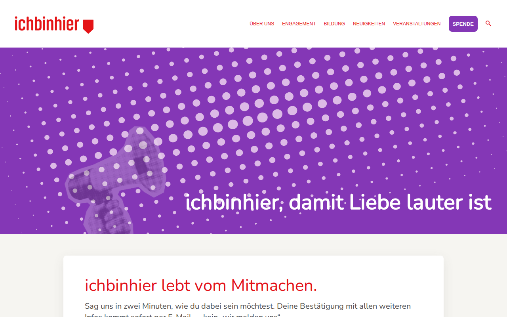
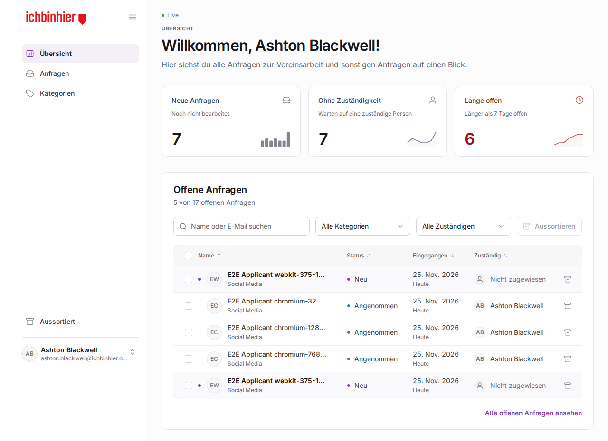

# Volunteer Intake Platform for "Ich bin hier e.V."

"Ich bin hier e.V." is a German association that works against online hate.
People who want to volunteer used to write to one shared inbox, and their
emails got lost among about a thousand others. This platform gives them their
own channel.

- **Applicant form.** A German web form that sorts each person into community
  member or applicant and answers at once with a concrete next step.
- **Staff dashboard.** One place where staff members review, filter and move
  Applications through their statuses, updated live.

Seven students built it in a three-week design-thinking workshop.

<p align="center">
  
  
</p>

Live demo: [applicant form](https://bewerbung.aegisdev.me) and
[staff dashboard](https://dashboard.aegisdev.me).

## Stack

| Part | Technology |
| --- | --- |
| [`frontend/`](./frontend/) | React 19, TypeScript, Vite, react-hook-form, Zod |
| [`dashboard/`](./dashboard/) | React 19, TypeScript, TanStack Query, Tailwind CSS |
| [`backend/`](./backend/) | Java 25, Spring Boot 4, PostgreSQL 17, Flyway |
| [`deploy/`](./deploy/) | Docker Compose, Caddy, GitHub Actions |

## Quick start

You need Docker with Compose.

```bash
cp .env.example .env    # set DB_PASSWORD and STAFF_1_PASSWORD … STAFF_5_PASSWORD
docker compose up -d --build
```

| Service | Address |
| --- | --- |
| Applicant form | <http://localhost:8081> |
| Staff dashboard | <http://localhost:8082> |
| Mailpit, catches outgoing emails | <http://localhost:8025> |

The database starts empty. To fill it with a demo week of Applications, start
the stack with the `demo` profile:

```bash
SPRING_PROFILES_ACTIVE=demo docker compose up -d --build
```

`docker compose down` stops the stack, and `docker compose down -v` also
deletes the database.

Open both apps as `localhost`. The dashboard's sign-in cookie is `Secure`, so
a browser rejects it over plain HTTP on any other host name. Enter synthetic
test data only.

## Documentation

| Document | What it holds |
| --- | --- |
| [`docs/ARCHITECTURE.md`](./docs/ARCHITECTURE.md) | Containers, ports, proxy and REST API rules |
| [`docs/adr/`](./docs/adr/) | Decisions that are hard to reverse, and why |
| [`deploy/README.md`](./deploy/README.md) | Release, staging and production deploy |
| [`backend/README.md`](./backend/README.md) | Packages, database schema, staff accounts, Swagger UI |
| [`docs/CASE.md`](./docs/CASE.md) | The client's problem and the Team Canvas |
| [`docs/ASSUMPTIONS.md`](./docs/ASSUMPTIONS.md) | Every number and process step we invented |
| [`CONTEXT.md`](./CONTEXT.md) | Domain vocabulary |
| [`AGENTS.md`](./AGENTS.md) | How to work in this repo |

## Team

Kamal, Ilyas, Tarek, Leon, Bohdan, Anna, Lawrence.
