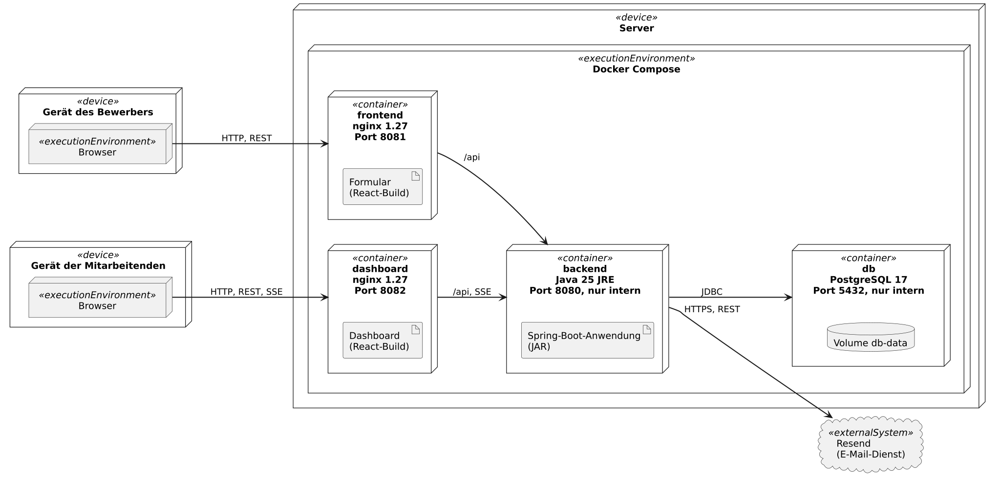
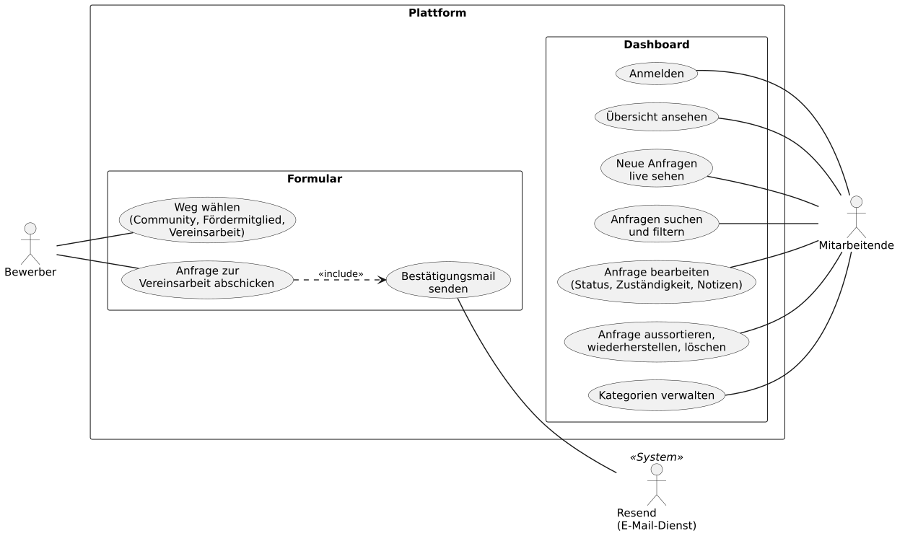

# Architektur

## Verteilungsdiagramm

Das UML-Verteilungsdiagramm zeigt, auf welchen Geräten und in welchen
Containern die Plattform läuft und wer mit wem spricht. Es entspricht dem
Aufbau, den [`docker-compose.yml`](../docker-compose.yml) startet.



### So liest man das Diagramm

| Element | Bedeutung |
|---|---|
| `<<device>>` | ein physisches Gerät: das Handy oder der Laptop eines Menschen, oder der Server |
| `<<executionEnvironment>>` | eine Laufzeitumgebung auf dem Gerät: der Browser oder Docker Compose |
| `<<container>>` | ein Docker-Container, darin steht die Software, die er ausführt |
| Artefakt (Blatt mit Eselsohr) | das ausgelieferte Programm: der React-Build oder die JAR-Datei |
| Pfeil | eine Verbindung, die Beschriftung nennt das Protokoll |
| `<<externalSystem>>` | ein fremder Dienst außerhalb unseres Servers |

### Die Bausteine

| Baustein | Was darin läuft | Aufgabe |
|---|---|---|
| Gerät des Bewerbers | Browser | zeigt das Bewerbungsformular |
| Gerät der Mitarbeitenden | Browser | zeigt das Dashboard für den Verein |
| `frontend` | nginx mit dem React-Build des Formulars | liefert das Formular aus und leitet `/api` an das Backend weiter |
| `dashboard` | nginx mit dem React-Build des Dashboards | liefert das Dashboard aus und leitet `/api` und die Live-Updates an das Backend weiter |
| `backend` | Spring-Boot-Anwendung auf Java 25 | prüft Eingaben, speichert Applications, verwaltet die Anmeldung und verschickt Bestätigungsmails |
| `db` | PostgreSQL 17 | speichert alle Daten dauerhaft im Volume `db-data` |
| Resend | externer E-Mail-Dienst | stellt die Bestätigungsmail an den Bewerber zu |

### Der Weg einer Bewerbung

1. Der Bewerber öffnet das Formular. Der `frontend`-Container schickt ihm die
   React-Anwendung.
2. Der Browser lädt die Kategorien und schickt die ausgefüllte Bewerbung an
   `/api`. nginx reicht beide Anfragen an das Backend weiter.
3. Das Backend prüft die Eingaben und speichert die Application in PostgreSQL.
4. Das Backend lässt Resend die Bestätigungsmail an den Bewerber schicken.
5. Das Backend meldet die neue Application per Server-Sent Events an jedes
   geöffnete Dashboard. Die Mitarbeitenden sehen sie sofort, ohne die Seite
   neu zu laden.
6. Ändern Mitarbeitende im Dashboard Status oder Owner, geht die Änderung über
   den `dashboard`-Container an das Backend. Das Backend speichert sie als
   State change.

### Warum so aufgebaut

- **Zwei getrennte Oberflächen.** Formular und Dashboard sind zwei eigene
  React-Anwendungen mit eigenem nginx
  ([ADR-0002](./adr/0002-dashboard-as-separate-application.md)). Das Formular
  bleibt klein und öffentlich, das Dashboard enthält nur, was Mitarbeitende
  nach der Anmeldung brauchen.
- **Seite und API von derselben Adresse.** Jeder nginx liefert die Seite aus
  und leitet `/api` selbst an das Backend weiter. Der Browser spricht nur mit
  einem Origin, eine CORS-Konfiguration ist nicht nötig.
- **Backend und Datenbank nur intern.** Beide sind nur im Netz von Docker
  Compose erreichbar. Von außen erreicht man die API nur über die zwei
  nginx-Container und die Datenbank gar nicht.
- **Live-Updates statt Neuladen.** Neue Applications und State changes
  erreichen das Dashboard über Server-Sent Events
  ([ADR-0004](./adr/0004-server-sent-events-for-the-dashboard.md)). Der
  `dashboard`-nginx puffert `/api/v1/staff/events` nicht und hält die
  Verbindung bis zu einer Stunde offen.
- **Mail ist optional.** Ohne `RESEND_API_KEY` verschickt das Backend keine
  Mail und schreibt nur Empfänger und Betreff ins Log. Für eine Demo reicht
  das.

Die Verbindungen zwischen Browser und nginx laufen im Prototyp über HTTP. TLS
käme erst mit einem Produktivbetrieb, der nicht zum MVP gehört.

## Anwendungsfälle des MVP

UML-Anwendungsfalldiagramm: wer was mit der Plattform tut, Stand `main` am
10.11.2026. Die Beschriftungen folgen der deutschen Oberfläche, deshalb heißt
eine Application hier _Anfrage_.



- Der Bewerber wählt im ersten Feld einen Weg. Community und Fördermitglied
  enden bei einem externen Link, nur Vereinsarbeit erzeugt eine Anfrage.
- Jede abgeschickte Anfrage löst die Bestätigungsmail aus, die Resend
  verschickt.
- Alle Anwendungsfälle im Dashboard setzen eine Anmeldung voraus.

## REST-Schnittstelle

Formular und Dashboard sprechen mit dem Backend nur über HTTP und JSON. Die
genauen Verträge stehen in [`frontend/API.md`](../frontend/API.md) und
[`dashboard/API.md`](../dashboard/API.md). Swagger UI zeigt die umgesetzten
Endpunkte, wenn das Backend mit dem Profil `docs` läuft (siehe
[`backend/README.md`](../backend/README.md), "API documentation"). Dieser
Abschnitt erklärt die Regeln, nach denen alle Endpunkte gebaut sind.

### Ressourcen und Pfade

Ein Pfad nennt eine Sache, keine Handlung: `/applications`, `/categories`,
`/route-selections`. Was die Anfrage tun soll, sagt das HTTP-Verb. Auch die
Anmeldung ist eine Ressource: `POST /api/v1/staff/session` meldet an,
`DELETE /api/v1/staff/session` meldet ab.

Alle Pfade beginnen mit `/api/v1`. Ändert sich ein Vertrag später inkompatibel,
bekommt die neue Fassung `/api/v2`, und die alten Clients laufen weiter. Die
Pfade für Mitarbeitende liegen unter `/api/v1/staff/` und verlangen eine
Anmeldung. Die übrigen sind öffentlich, und das Backend öffnet jeden einzeln
mit Methode und Pfad (`SecurityConfig`). Eine Ausnahme ist die
Onboarding-Checkliste unter `/api/onboarding/{token}`: sie trägt noch kein
`v1`.

### Verben

| Verb | Bedeutung | Beispiel |
|---|---|---|
| `GET` | liest und ändert nichts | `GET /api/v1/categories` |
| `POST` | legt etwas Neues an | `POST /api/v1/applications` |
| `PATCH` | ändert einzelne Felder, die übrigen bleiben | `PATCH /api/v1/staff/applications/{id}` mit `{"status":"IN_REVIEW"}` |
| `PUT` | ersetzt einen Wert als Ganzes, zweimal gesendet ergibt dasselbe | `PUT /api/v1/staff/categories/order` |
| `DELETE` | entfernt etwas | `DELETE /api/v1/staff/categories/{id}` |

`GET`, `PUT` und `DELETE` sind idempotent: dieselbe Anfrage zweimal hat dieselbe
Wirkung wie einmal. `POST /api/v1/applications` ist es von Natur aus nicht.
Deshalb schickt das Formular eine `submissionId` mit, und das Backend legt zu
einer `submissionId` nur eine Application an.

### Statuscodes

| Code | Bedeutung | Wo |
|---|---|---|
| `200 OK` | Antwort mit Inhalt | Lesen, Ändern |
| `201 Created` | etwas wurde angelegt | neue Application, neue Category |
| `202 Accepted` | angenommen, ohne Inhalt in der Antwort | Zähler für den gewählten Weg |
| `204 No Content` | erledigt, nichts zurückzugeben | Löschen, Abmelden |
| `400 Bad Request` | Eingabe ungültig | Pflichtfeld fehlt, E-Mail falsch |
| `401 Unauthorized` | nicht angemeldet oder Anmeldung abgelaufen | alle Pfade unter `/staff/` |
| `403 Forbidden` | angemeldet, aber nicht erlaubt | ein Pfad, den das Backend nicht freigibt |
| `404 Not Found` | die genannte Ressource gibt es nicht | unbekannte Application-ID |
| `409 Conflict` | widerspricht dem aktuellen Zustand | eine Category löschen, die noch verwendet wird |
| `429 Too Many Requests` | zu viele Versuche, mit `Retry-After` | Anmeldung (`A20`), Bewerbungen pro Adresse (`A26`) |
| `500 Internal Server Error` | Fehler im Backend | nie absichtlich |

### Fehler nach RFC 9457

Jeder Fehler hat denselben Aufbau, `application/problem+json` nach
[RFC 9457](https://www.rfc-editor.org/rfc/rfc9457):

```json
{
  "type": "https://ichbinhier.eu/problems/validation-failed",
  "title": "Validation failed",
  "status": 400,
  "code": "VALIDATION_FAILED",
  "errors": [{ "field": "email", "code": "EMAIL_INVALID" }]
}
```

Formular und Dashboard lesen nur `code` und die `errors` pro Feld und zeigen
dazu ihren eigenen deutschen Text. Das Backend schickt keine Fehlermeldungen
auf Deutsch, damit der Wortlaut an einer Stelle geprüft wird.

### Zustandslos, mit Cookie

Jede Anfrage bringt alles mit, was das Backend zu ihrer Bearbeitung braucht.
Im Speicher hält es nur zwei Dinge: die offenen Anmeldungen und die
fehlgeschlagenen Anmeldeversuche pro Adresse (`A17`, `A20`). Die Anmeldung
steckt in einem `HttpOnly`-Cookie, das der Browser bei jeder Anfrage
mitschickt. Ein Token im JavaScript gibt es nicht.

### Live-Updates mit Server-Sent Events

`GET /api/v1/staff/events` antwortet mit `text/event-stream` und hält die
Verbindung offen. Das Backend schickt jede neue oder geänderte Application als
Ereignis an jedes geöffnete Dashboard
([ADR-0004](./adr/0004-server-sent-events-for-the-dashboard.md)). SSE reicht
hier, weil die Daten nur vom Server zum Browser fließen. Änderungen schickt
das Dashboard weiter als normale `PATCH`-Anfrage.

## Diagramme neu erzeugen

Die Quellen liegen in [`diagrams/`](./diagrams/) als `.puml`-Dateien. Lokal ist
kein Java nötig, PlantUML läuft im Container:

```sh
cd docs/diagrams
docker run --rm -u "$(id -u):$(id -g)" -v "$PWD":/data -w /data \
  plantuml/plantuml -tsvg *.puml
docker run --rm -u "$(id -u):$(id -g)" -v "$PWD":/data -w /data \
  plantuml/plantuml -tpng -Sdpi=200 *.puml
```

Die PNG-Dateien sind für die Folien gedacht, die SVG-Dateien für dieses
Dokument.
