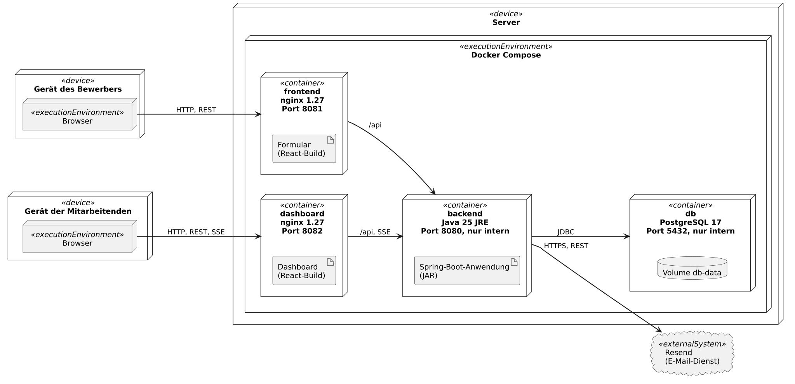
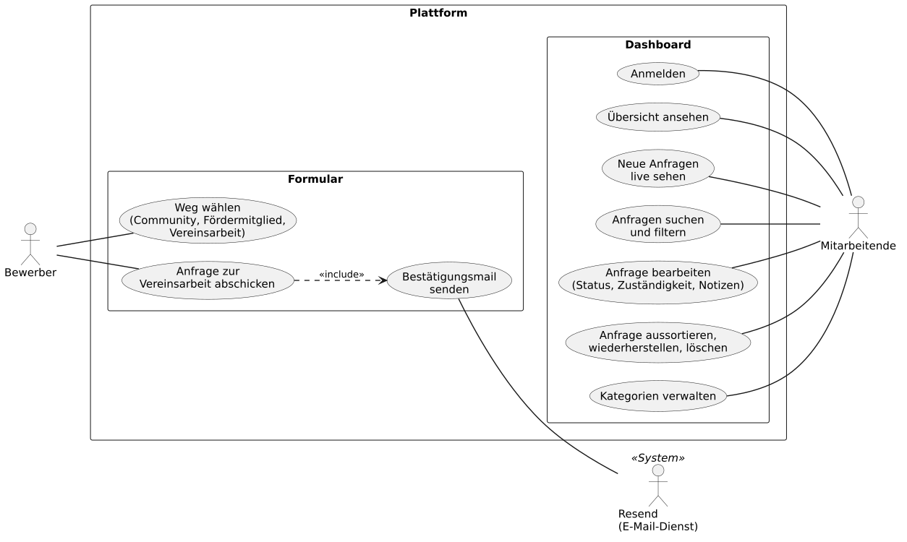

# Architektur

## Verteilungsdiagramm

Das UML-Verteilungsdiagramm zeigt, auf welchen Geräten und in welchen
Containern die Plattform läuft und wer mit wem spricht. Es entspricht dem
Aufbau, den [`docker-compose.yml`](../docker-compose.yml) startet.



### So liest man das Diagramm

| Element | Bedeutung |
|---|---|
| `<<device>>` | ein physisches Gerät: das Handy oder der Laptop eines Menschen, oder der Server |
| `<<executionEnvironment>>` | eine Laufzeitumgebung auf dem Gerät: der Browser oder Docker Compose |
| `<<container>>` | ein Docker-Container, darin steht die Software, die er ausführt |
| Artefakt (Blatt mit Eselsohr) | das ausgelieferte Programm: der React-Build oder die JAR-Datei |
| Pfeil | eine Verbindung, die Beschriftung nennt das Protokoll |
| `<<externalSystem>>` | ein fremder Dienst außerhalb unseres Servers |

### Die Bausteine

| Baustein | Was darin läuft | Aufgabe |
|---|---|---|
| Gerät des Bewerbers | Browser | zeigt das Bewerbungsformular |
| Gerät der Mitarbeitenden | Browser | zeigt das Dashboard für den Verein |
| `frontend` | nginx mit dem React-Build des Formulars | liefert das Formular aus und leitet `/api` an das Backend weiter |
| `dashboard` | nginx mit dem React-Build des Dashboards | liefert das Dashboard aus und leitet `/api` und die Live-Updates an das Backend weiter |
| `backend` | Spring-Boot-Anwendung auf Java 25 | prüft Eingaben, speichert Applications, verwaltet die Anmeldung und verschickt Bestätigungsmails |
| `db` | PostgreSQL 17 | speichert alle Daten dauerhaft im Volume `db-data` |
| Resend | externer E-Mail-Dienst | stellt die Bestätigungsmail an den Bewerber zu |

### Der Weg einer Bewerbung

1. Der Bewerber öffnet das Formular. Der `frontend`-Container schickt ihm die
   React-Anwendung.
2. Der Browser lädt die Kategorien und schickt die ausgefüllte Bewerbung an
   `/api`. nginx reicht beide Anfragen an das Backend weiter.
3. Das Backend prüft die Eingaben und speichert die Application in PostgreSQL.
4. Das Backend lässt Resend die Bestätigungsmail an den Bewerber schicken.
5. Das Backend meldet die neue Application per Server-Sent Events an jedes
   geöffnete Dashboard. Die Mitarbeitenden sehen sie sofort, ohne die Seite
   neu zu laden.
6. Ändern Mitarbeitende im Dashboard Status oder Owner, geht die Änderung über
   den `dashboard`-Container an das Backend. Das Backend speichert sie als
   State change.

### Warum so aufgebaut

- **Zwei getrennte Oberflächen.** Formular und Dashboard sind zwei eigene
  React-Anwendungen mit eigenem nginx
  ([ADR-0002](./adr/0002-dashboard-as-separate-application.md)). Das Formular
  bleibt klein und öffentlich, das Dashboard enthält nur, was Mitarbeitende
  nach der Anmeldung brauchen.
- **Seite und API von derselben Adresse.** Jeder nginx liefert die Seite aus
  und leitet `/api` selbst an das Backend weiter. Der Browser spricht nur mit
  einem Origin, eine CORS-Konfiguration ist nicht nötig.
- **Backend und Datenbank nur intern.** Beide sind nur im Netz von Docker
  Compose erreichbar. Von außen erreicht man die API nur über die zwei
  nginx-Container und die Datenbank gar nicht.
- **Live-Updates statt Neuladen.** Neue Applications und State changes
  erreichen das Dashboard über Server-Sent Events
  ([ADR-0004](./adr/0004-server-sent-events-for-the-dashboard.md)). Der
  `dashboard`-nginx puffert `/api/v1/staff/events` nicht und hält die
  Verbindung bis zu einer Stunde offen.
- **Mail ist optional.** Ohne `RESEND_API_KEY` verschickt das Backend keine
  Mail und schreibt nur Empfänger und Betreff ins Log. Für eine Demo reicht
  das.

Die Verbindungen zwischen Browser und nginx laufen im Prototyp über HTTP. TLS
käme erst mit einem Produktivbetrieb, der nicht zum MVP gehört.

## Anwendungsfälle des MVP

UML-Anwendungsfalldiagramm: wer was mit der Plattform tut, Stand `main` am
10.11.2026. Die Beschriftungen folgen der deutschen Oberfläche, deshalb heißt
eine Application hier _Anfrage_.



- Der Bewerber wählt im ersten Feld einen Weg. Community und Fördermitglied
  enden bei einem externen Link, nur Vereinsarbeit erzeugt eine Anfrage.
- Jede abgeschickte Anfrage löst die Bestätigungsmail aus, die Resend
  verschickt.
- Alle Anwendungsfälle im Dashboard setzen eine Anmeldung voraus.

## Diagramme neu erzeugen

Die Quellen liegen in [`diagrams/`](./diagrams/) als `.puml`-Dateien. Lokal ist
kein Java nötig, PlantUML läuft im Container:

```sh
cd docs/diagrams
docker run --rm -u "$(id -u):$(id -g)" -v "$PWD":/data -w /data \
  plantuml/plantuml -tsvg *.puml
docker run --rm -u "$(id -u):$(id -g)" -v "$PWD":/data -w /data \
  plantuml/plantuml -tpng -Sdpi=200 *.puml
```

Die PNG-Dateien sind für die Folien gedacht, die SVG-Dateien für dieses
Dokument.
