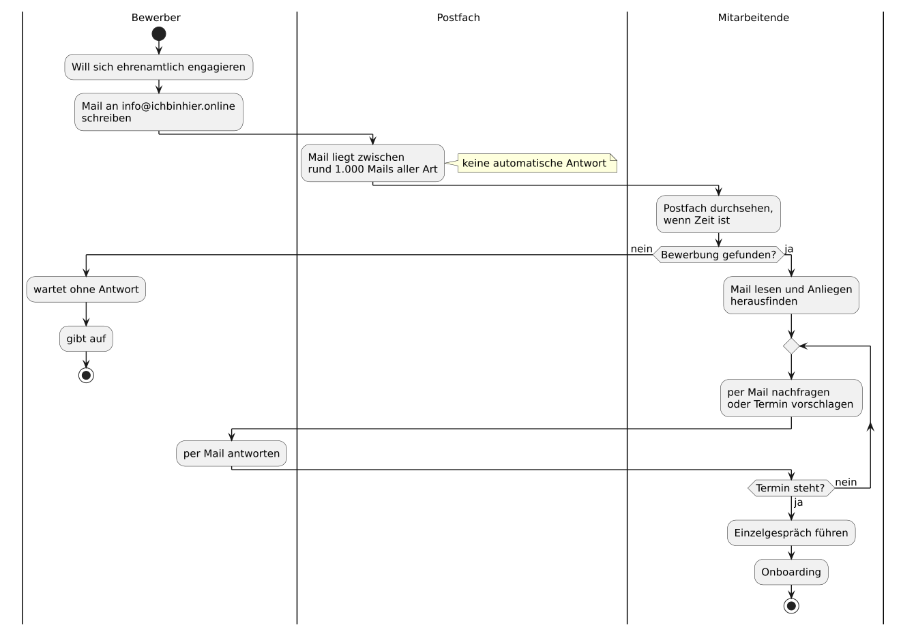
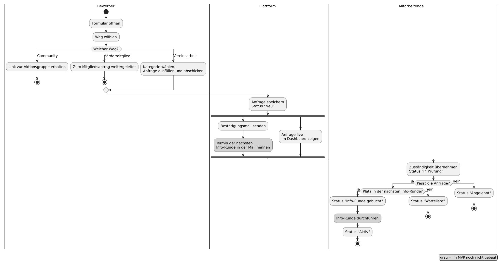

# Prozess der Bewerbungsannahme

## Ist-Prozess

So läuft die Bewerbungsannahme heute, rekonstruiert aus dem, was der Verein
uns gesagt hat (`C2`, [`CASE.md`](./CASE.md)). Die Reihenfolge der Schritte und
das Einzelgespräch sind unsere Annahme (`A25`), weil der Verein uns seinen
Ablauf nie gezeigt hat (`C1`).

1. Ein Interessent liest einen Aufruf des Vereins und schreibt eine Mail an
   `info@ichbinhier.online` (`A6`).
2. Die Mail landet im allgemeinen Postfach, zwischen rund 1.000 Mails aller
   Art: Rechnungen, Presse, Newsletter, Spam (`C2`, `A3`).
3. Niemand antwortet automatisch. Der Interessent weiß nicht, ob seine Mail
   angekommen ist (`A8`).
4. Jemand aus dem Team sieht das Postfach durch, wenn Zeit ist, und muss die
   Bewerbung darin erst finden (`C2`).
5. Wird die Mail nicht gefunden, bleibt sie liegen. Der Interessent hört nichts
   und gibt irgendwann auf (`A8`).
6. Wird sie gefunden, liest jemand sie und klärt, was der Interessent will. Wer
   nur in der Community mitmachen will, geht denselben Weg, obwohl er niemanden
   im Team braucht (`A5`).
7. Rückfragen und Terminvorschläge gehen per Mail hin und her, bis ein Termin
   steht.
8. Jemand aus dem Team führt ein Einzelgespräch mit dem Interessenten.
9. Danach beginnt das Onboarding.

Die Schwachstellen liegen in den Schritten 2 bis 7: Bewerbungen sind nicht
auffindbar, Bewerber bekommen keine Antwort, Community-Anfragen kosten
Arbeitszeit, und jeder Termin braucht mehrere Mails. Der Soll-Prozess setzt
genau dort an.

## Soll-Prozess

UML-Aktivitätsdiagramm von der Bewerbung bis zum Onboarding. Die Status folgen
`A9` und heißen so wie in der Oberfläche des Dashboards. Graue Schritte sind im
MVP noch nicht gebaut.

- **Bewerber.** Das erste Feld des Formulars trennt drei Wege. Community und
  Fördermitglied enden bei einem externen Link und kosten die Mitarbeitenden
  keine Zeit. Wenn `A5` stimmt, sind das vier von fünf Interessenten. Nur
  Vereinsarbeit erzeugt eine Anfrage.
- **Plattform.** Die Anfrage wird mit dem Status "Neu" gespeichert. Gleichzeitig
  geht die Bestätigungsmail raus, und die Anfrage erscheint ohne Neuladen im
  Dashboard ([ADR-0004](./adr/0004-server-sent-events-for-the-dashboard.md)).
  Den Termin der nächsten Info-Runde nennt die Mail noch nicht, weil es für
  Info-Runden kein Datenmodell gibt.
- **Mitarbeitende.** Wer eine Anfrage übernimmt, setzt sich als zuständig und
  den Status auf "In Prüfung". Danach führt die Anfrage zu "Info-Runde gebucht"
  und "Aktiv", zu "Warteliste" oder zu "Abgelehnt". Die Info-Runde alle zwei
  Wochen ist unsere Annahme (`A10`). Sie findet außerhalb der Plattform statt.

Das Backend prüft die Statusübergänge heute nicht, jeder Übergang ist erlaubt
(#78). Das Diagramm zeigt den gedachten Weg, nicht eine Regel im Code.

Die Quelle ist [`diagrams/soll-process.puml`](./diagrams/soll-process.puml). Zum
Rendern wird die PNG-Datei wegen ihrer Breite mit
`-e PLANTUML_LIMIT_SIZE=8192` erzeugt.

## Vorher und Nachher

Die Tabelle vergleicht beide Prozesse Schritt für Schritt. Sie beruht auf
unserer Rekonstruktion des Ist-Prozesses (`A25`). Sortiert der Verein heute
schon anders, als wir annehmen, fällt der Gewinn kleiner aus.

| Schritt | Vorher | Nachher | Warum besser |
|---|---|---|---|
| Eingang | Freitext-Mail an `info@ichbinhier.online`, zwischen rund 1.000 Mails aller Art (`C2`, `A3`, `A6`). | Formular. Jede Bewerbung wird eine Anfrage mit Kategorie, Status "Neu" und Eingangsdatum und erscheint ohne Neuladen im Dashboard ([ADR-0004](./adr/0004-server-sent-events-for-the-dashboard.md)). | Niemand muss Bewerbungen im Postfach suchen. Sie stehen getrennt von Rechnungen, Presse und Spam in einer eigenen Liste. |
| Antwort | Keine automatische Antwort. Der Interessent weiß nicht, ob seine Mail angekommen ist (`A8`). | Bestätigungsmail direkt nach dem Absenden. | Kein Bewerber bleibt ohne Rückmeldung. Nachfragen wie "Ist meine Mail angekommen?" fallen weg (`A8`). |
| Triage | Jemand liest jede Mail und klärt, was der Interessent will. Community-Anfragen gehen denselben Weg (`A5`). | Das erste Formularfeld trennt Community, Fördermitglied und Vereinsarbeit. Nur Vereinsarbeit erzeugt eine Anfrage. Mitarbeitende übernehmen die Zuständigkeit, und nach 7 Tagen ohne Bewegung steht die Anfrage unter "Lange offen" (`A19`). | Wenn `A5` stimmt, erreichen vier von fünf Interessenten das Team gar nicht mehr. Jede Anfrage hat eine zuständige Person und ein sichtbares Alter. |
| Termin | Rückfragen und Terminvorschläge per Mail, bis ein Einzelgespräch steht (`A25`). | Info-Runde alle zwei Wochen für alle Bewerber, Status "Info-Runde gebucht" (`A10`). Den Termin nennt die Bestätigungsmail im MVP noch nicht. | Eine Stunde einer Person reicht für bis zu fünfzig Bewerber statt eines Gesprächs pro Person (`A10`). Die Mails zur Terminfindung entfallen erst, wenn die Bestätigungsmail den Termin nennt. |
| Onboarding | Beginnt nach dem Einzelgespräch. Wie es abläuft, wissen wir nicht (`C1`). | Status "Aktiv" markiert den Beginn. Das Onboarding selbst läuft weiter außerhalb der Plattform. | Im MVP keine Verbesserung, nur der Überblick, wer aktiv ist. Erfahrene Freiwillige als Paten (`A11`) sind eine Idee und nicht gebaut. |
