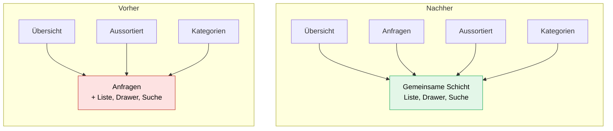
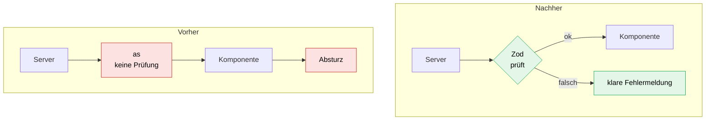
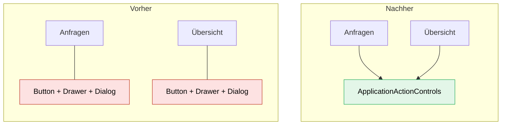
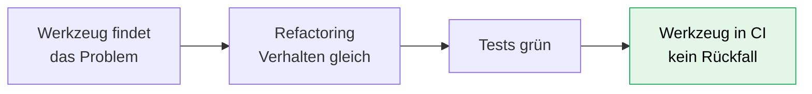

# Drei Refactorings im Frontend

| # | Problem | Vorher | Nachher |
|---|---|---|---|
| 1 | Bildschirme hängen voneinander ab | 17 | 0 Importe |
| 2 | Daten ungeprüft übernommen | 24 | 0 `as` |
| 3 | Code doppelt | 10 | 0 Klone |

Stand `origin/main` bei `43c2a87`, 25.11.2026. Details in
[`REFACTORING.md`](./REFACTORING.md).

## 1. Bildschirme unabhängig machen

**Problem:** Änderst du Anfragen, gehen drei andere Bildschirme kaputt.

**Lösung:** Geteilte Teile in eine gemeinsame Schicht (`14ec1f0`).

**Besser:** Jeder Bildschirm steht für sich. ESLint verhindert den Rückfall.

## 2. Daten prüfen statt vertrauen

**Problem:** `as` glaubt dem Server blind. Falsche Daten stürzen erst später ab.

**Lösung:** Zod prüft jede Antwort beim Ankommen (`0764e9f`, `ea757c9`).

**Besser:** Der Fehler zeigt sich dort, wo er entsteht. ESLint verbietet `as`.

## 3. Einmal schreiben statt kopieren

**Problem:** Button, Drawer und Dialog standen in zwei Bildschirmen doppelt.

**Lösung:** Ein gemeinsames Teil für beide (`9c53480`, `c4d9484`, `07b46ec`).

**Besser:** Eine Änderung wirkt überall. `jscpd` meldet jeden neuen Klon.

## Das Muster hinter allen drei

