# Bildschirmgrößen

Das Bewerbungsformular und das Dashboard laufen auf dem Handy, dem Tablet und
dem Desktop. Diese Seite hält fest, mit welchen Breiten wir das prüfen, was die
Prüfung abdeckt und wie die Oberfläche bei jeder Breite aussieht.

## Die drei Breiten

| Gerät | Breite | E2E-Projekt | Screenshot-Projekt |
|---|---|---|---|
| Handy | 320 px und 375 px | `chromium-320`, `webkit-375` | `phone-375` |
| Tablet | 768 px | `chromium-768` | `tablet-768` |
| Desktop | 1280 px | `chromium-1280` | `desktop-1280` |

320 px ist die kleinste Breite, die beide Anwendungen unterstützen (siehe
[`STANDARD.md`](./STANDARD.md), "Breiten ab 320 px"). 375 px ist ein
gängiges Handy, 768 px ein Tablet im Hochformat.

## Was geprüft wird

Die E2E-Tests in [`../e2e/tests/`](../e2e/tests/) laufen in CI bei jeder
Breite aus der Tabelle:

- Ein Bewerber schickt das Formular ab, eine Mitarbeiterin übernimmt die
  Application und ändert ihren Status (`application-flow.spec.ts`).
- axe prüft das Formular, die Anmeldung, Übersicht, Anfragen, Kategorien,
  Aussortiert und die Onboarding-Seite auf WCAG 2.2 AA
  (`accessibility.spec.ts`).
- Auf jeder dieser Seiten darf nichts seitlich über den Bildschirm hinausragen.

WebKit prüft nur das Formular und die Onboarding-Seite. Unter Linux schickt
WebKit das `Secure`-Cookie der Anmeldung über `http://localhost` nicht mit.

## Ergebnis

Alle Tests laufen bei allen vier Projekten durch. Bei 768 px kam ein Befund
heraus, der im Test lag und nicht in der Oberfläche: Das Dashboard öffnet eine
Application erst ab 1024 px in einer Seitenleiste. Darunter ersetzt die
Detailansicht die Liste. Der Test hatte die schmale Ansicht nur bei 320 px
erwartet und wählt sie jetzt nach der Breite.

Bei 320 und 375 px passen die drei Reiter der Anfragen-Liste nicht ganz auf
den Bildschirm. Die Reiterleiste lässt sich waagerecht scrollen, und der Rand,
hinter dem ein Reiter liegt, blendet aus (#207). Ein angeklickter oder per
Tastatur erreichter Reiter rückt ganz ins Bild. Das prüft
`e2e/tests/tab-strip.spec.ts` bei 320 px. Die Seite selbst ragt nicht über den
Rand, das prüft der E2E-Test zur Barrierefreiheit.

## Screenshots

`npm run screenshots` in `e2e/` nimmt die Bilder gegen den laufenden
Compose-Stack auf. CI führt das nicht aus. Bevor ein Bild gespeichert wird,
ersetzt das Skript Name, E-Mail und Initialen jeder Application, deren
E-Mail-Adresse nicht auf `@example.org` endet. Die Liste zeigt neben den
Demo-Daten auch die Applications, die die E2E-Tests anlegen.

### Formular, Start

| Handy (375 px) | Tablet (768 px) | Desktop (1280 px) |
|---|---|---|
| 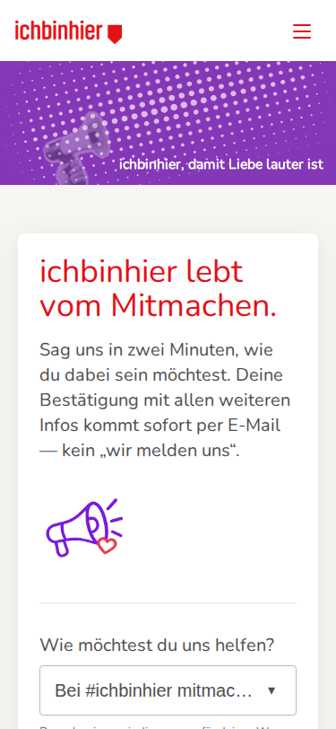 | 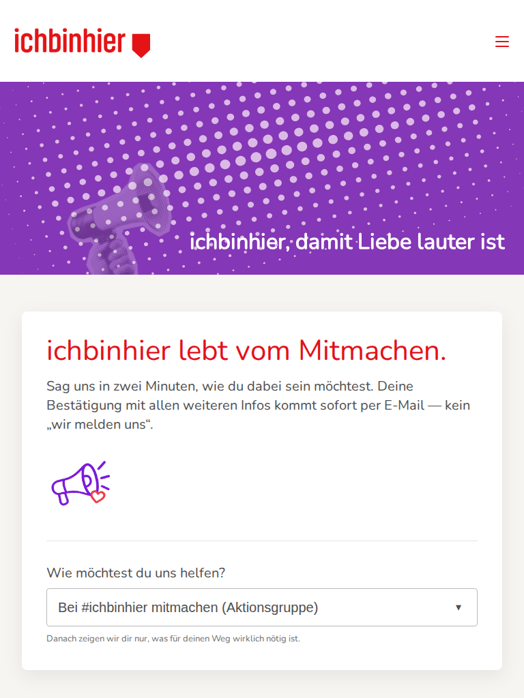 | 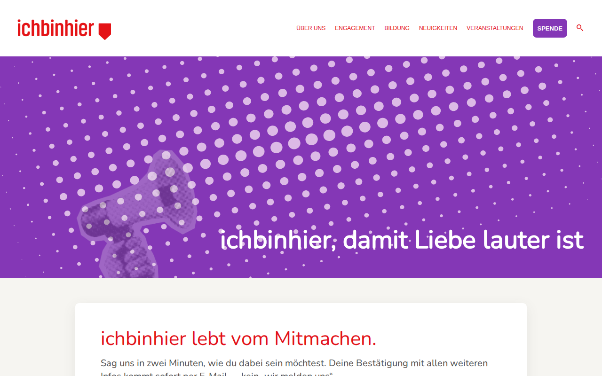 |

### Formular, ausgefüllt

| Handy (375 px) | Tablet (768 px) | Desktop (1280 px) |
|---|---|---|
| 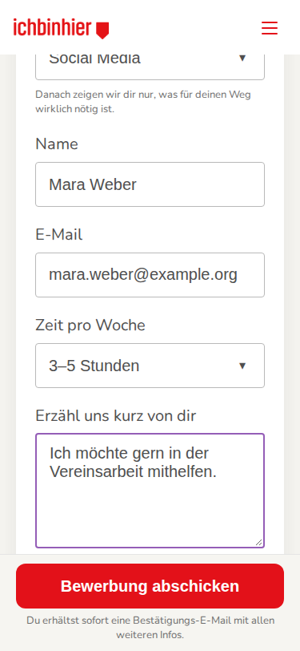 | 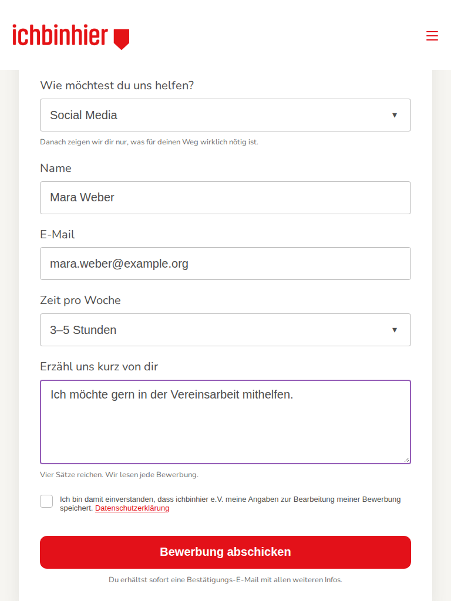 | 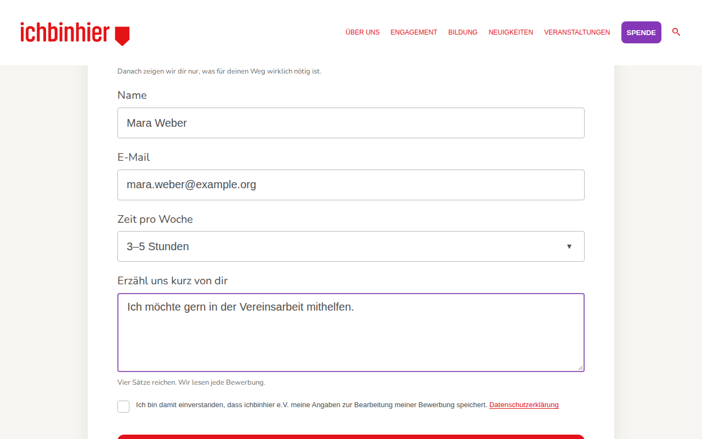 |

### Dashboard, Übersicht

| Handy (375 px) | Tablet (768 px) | Desktop (1280 px) |
|---|---|---|
| 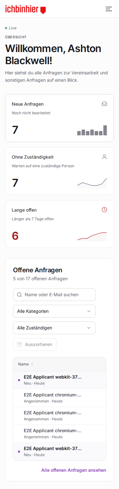 | 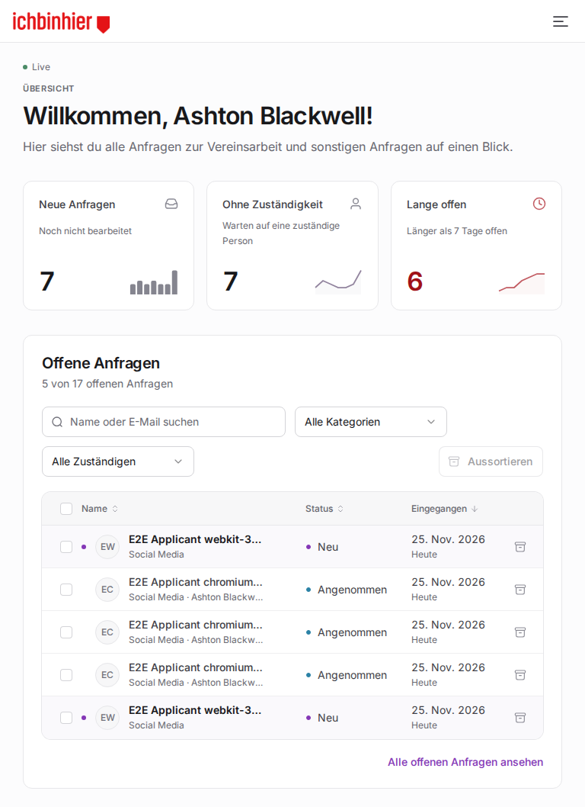 | 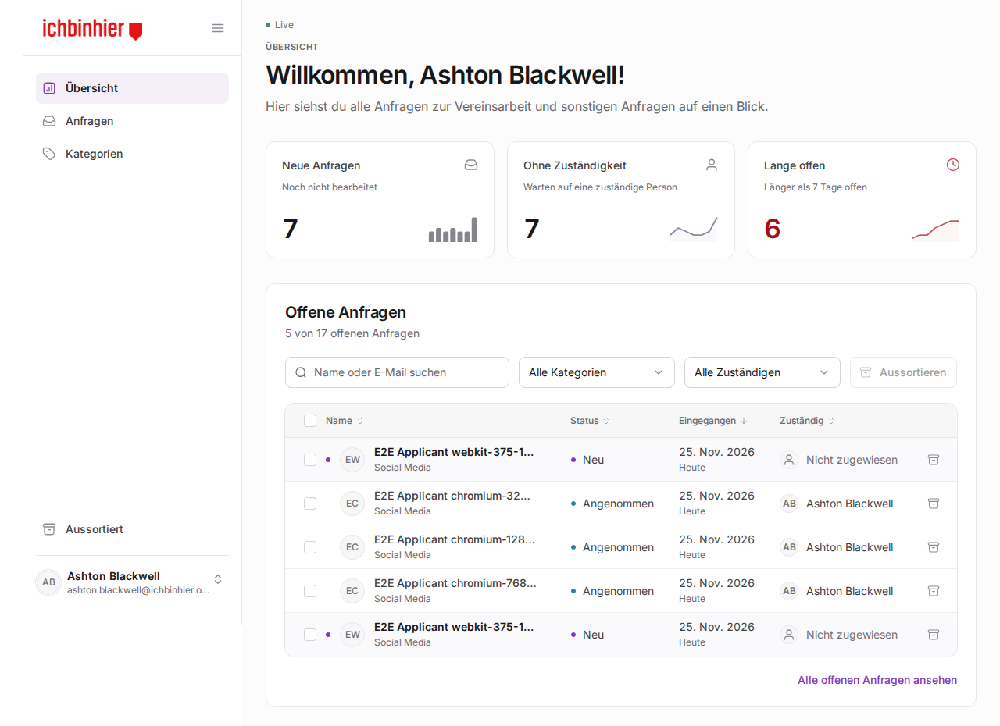 |

### Dashboard, Anfragen

| Handy (375 px) | Tablet (768 px) | Desktop (1280 px) |
|---|---|---|
| 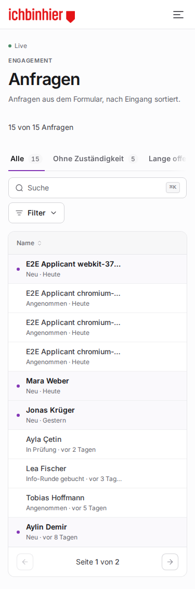 | 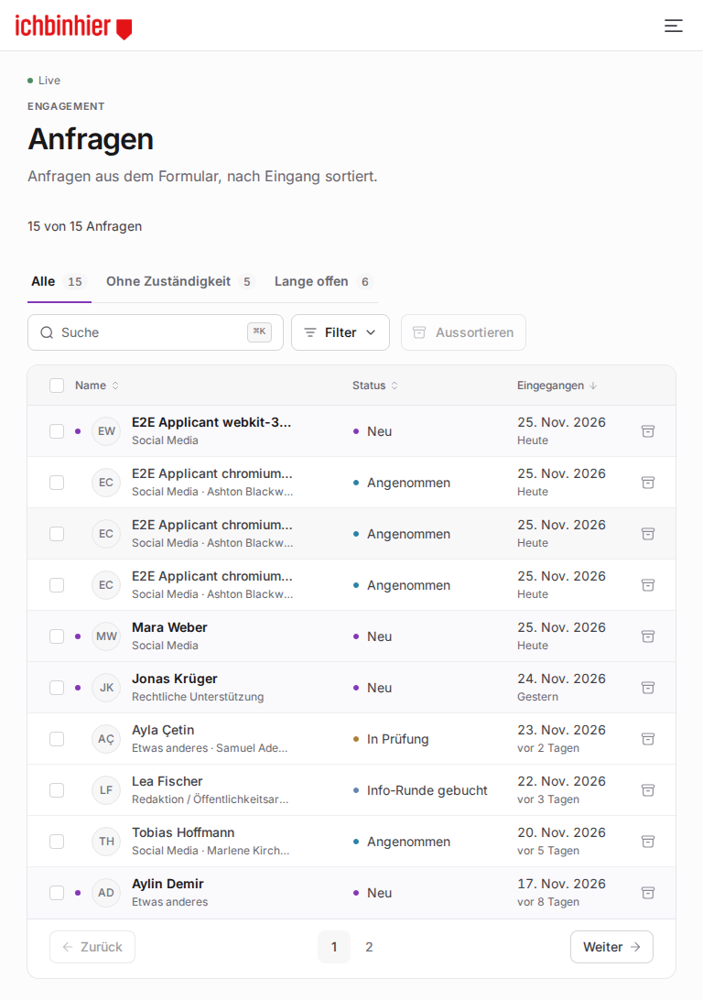 | 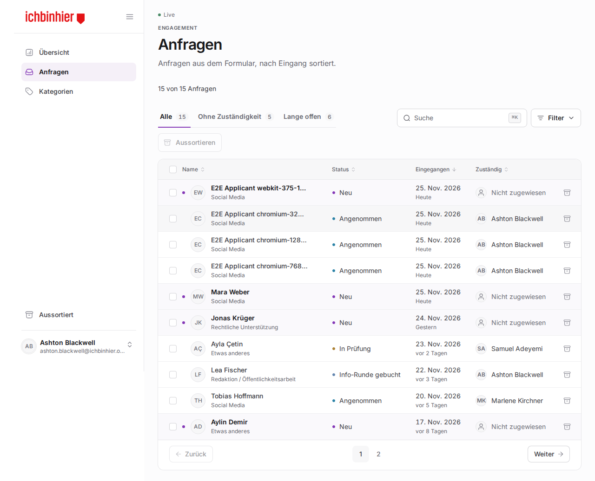 |
