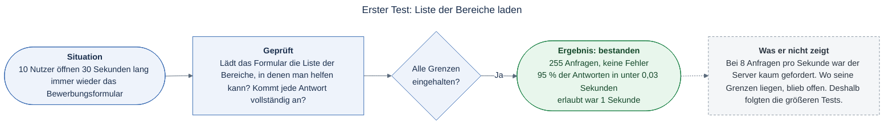
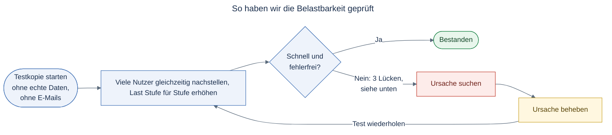
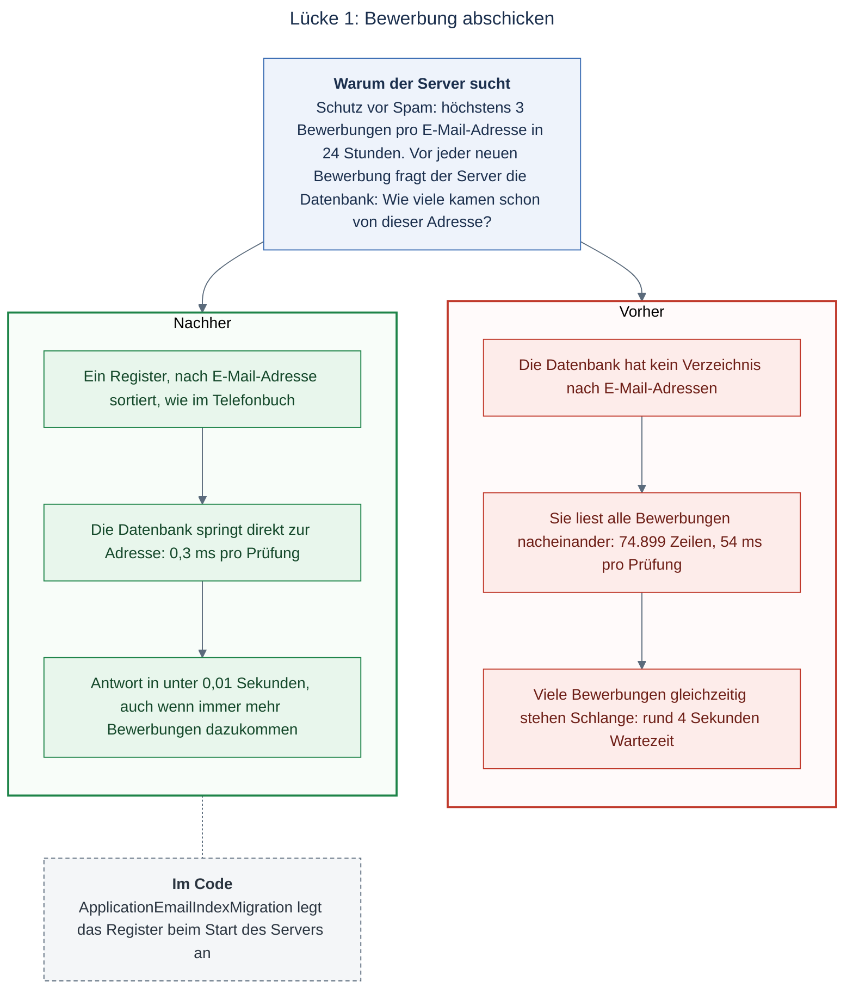
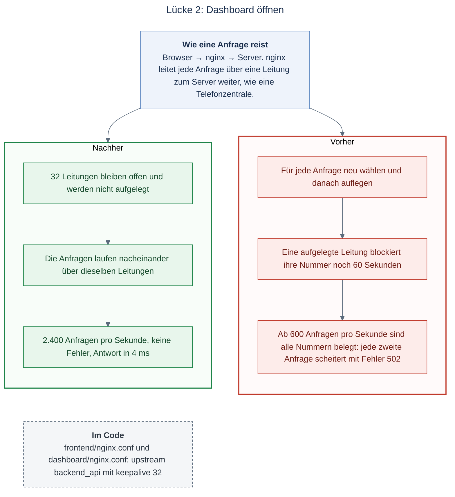
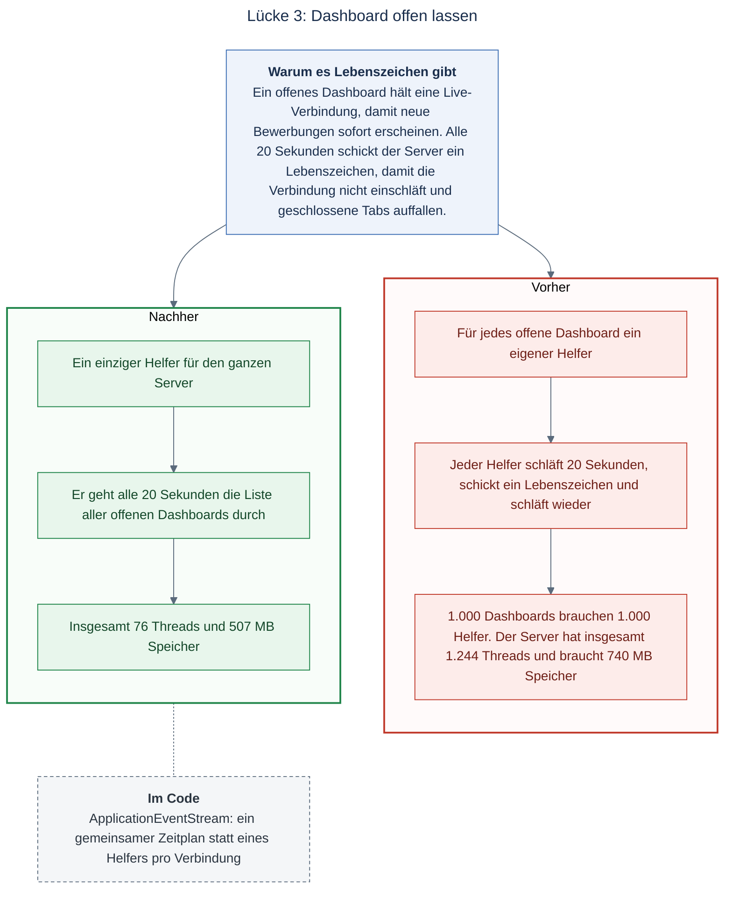

# Ergebnisse der Lasttests

Lauf am 25.11.2026 gegen einen eigenen Compose-Stack (`dtw-load`, siehe
`README.md`) mit den Demo-Daten und leerem `RESEND_API_KEY`. k6 und der Stack
liefen auf demselben Rechner: 22 Kerne, 15 GB RAM, WSL 2, keine Grenzen für
CPU oder Speicher der Container. Die Zahlen gelten für diesen Rechner und
sagen nichts über einen Server im Internet.

Eine erwartete Last gibt es noch nicht, weil die Zahl der Anfragen unbekannt
ist (`A4`). Deshalb liefen nur Smoke, Stress und Spike. Load und Soak brauchen
diese Annahme (#198).

## Erster Test: Liste der Bereiche

Zuerst lief ein kleiner Test gegen das Formular. Er hat bestanden, war aber zu
klein, um Grenzen zu finden.



Technisch: `categories.js` ruft `GET /api/v1/categories` über nginx auf, mit
10 virtuellen Nutzern und einer Sekunde Pause zwischen den Anfragen (`A31`).
Der Lauf vom 25.11.2026 hatte 255 Anfragen, 8,4 Anfragen pro Sekunde, 0 %
Fehler, alle 510 Prüfungen bestanden und p95 27,41 ms bei einer Schwelle von
1 s. Das Beispiel in `README.md` stammt aus einem anderen Lauf (p95 15,94 ms).

## Größere Tests: So sind wir vorgegangen

Danach haben wir eine Testkopie der Anwendung so lange stärker belastet, bis
etwas langsam wurde oder Fehler zeigte. Dann haben wir die Ursache behoben und
denselben Test wiederholt. Dabei kamen drei Lücken ans Licht.



| Lücke | Vorher | Nachher |
| --- | --- | --- |
| 1. Bewerbung abschicken | rund 4 Sekunden Wartezeit | unter 0,01 Sekunden |
| 2. Dashboard öffnen | jede zweite Anfrage scheiterte | keine Fehler |
| 3. Dashboard offen lassen | 1.000 Helfer für 1.000 Dashboards | 1 Helfer, ein Drittel weniger Speicher |

## Lücke 1: Bewerbung abschicken



**Warum der Server sucht.** Damit niemand über das Formular massenhaft
E-Mails an fremde Adressen auslöst, nimmt der Server von einer E-Mail-Adresse
höchstens 3 Bewerbungen in 24 Stunden an (`A26`). Vor jeder neuen Bewerbung
fragt er deshalb die Datenbank: Wie viele Bewerbungen kamen in den letzten
24 Stunden von dieser Adresse?

**Was schiefging.** Die Datenbank speichert Bewerbungen einfach als Zeilen, in
der Reihenfolge, in der sie ankommen. Ein Verzeichnis nach E-Mail-Adresse gab
es nicht. Um die Frage zu beantworten, las sie jedes Mal alle Zeilen und
verglich die Adresse in jeder einzelnen. Bei 13 Bewerbungen fällt das nicht
auf. Bei 74.899 Bewerbungen dauerte eine Prüfung 54 ms. Weil jede neue
Bewerbung diese Prüfung braucht, standen sie bei vielen gleichzeitigen
Bewerbungen Schlange, und die Wartezeit stieg auf rund 4 Sekunden. Je mehr
Bewerbungen gespeichert sind, desto langsamer wird es.

**Wie wir es behoben haben.** Wir haben der Datenbank ein Register gegeben,
technisch einen Index: eine eigene, nach E-Mail-Adresse sortierte Liste, die
zu jeder Adresse auf ihre Bewerbungen zeigt. Das ist wie das Stichwortregister
am Ende eines Buchs oder ein Telefonbuch: Wer „Müller“ sucht, schlägt direkt
bei M auf. Jetzt dauert die Prüfung 0,3 ms statt 54 ms und wird auch mit
wachsender Tabelle kaum langsamer.

**Wo im Code.** Pfade ab `backend/src/main/`:

- Die Grenze steht in `resources/application.properties`:
  `application-limit.per-email=3` und `application-limit.window=24h`.
- Die Prüfung ist die Methode `throwIfEmailOverLimit` in
  `ApplicationSubmissionServiceImpl`. Sie fragt das Repository nach den
  Bewerbungen der Adresse aus den letzten 24 Stunden und antwortet mit `429`,
  wenn es schon 3 sind.
- Die Abfrage selbst ist die Methode
  `findByEmailIgnoreCaseAndSubmittedAtAfterOrderBySubmittedAtAsc` in
  `ApplicationRepository`. SQL schreibt dort niemand: Spring Data baut es aus
  dem Methodennamen, ungefähr so:

  ```sql
  WHERE upper(email) = upper(?) AND submitted_at > ? ORDER BY submitted_at
  ```

  `IgnoreCase` wird zu `upper()`, damit `Anna@x.de` und `anna@x.de` als
  dieselbe Adresse zählen. Genau für diesen Ausdruck fehlte der Index.
- Die Lösung ist die neue Klasse `ApplicationEmailIndexMigration`. Sie läuft
  einmal beim Start des Servers, nachdem Hibernate das Schema aktualisiert hat,
  und legt das Register an:

  ```sql
  CREATE INDEX IF NOT EXISTS ix_applications_upper_email_submitted_at
      ON applications (upper(email), submitted_at)
  ```

  `IF NOT EXISTS` macht einen erneuten Start harmlos. Hibernate kann keinen
  Index auf einen Ausdruck wie `upper(email)` deklarieren, deshalb die eigene
  Klasse. Auf H2 in den Tests tut sie nichts, wie die benachbarte
  `ApplicationStatusConstraintMigration`.

**Messwerte.**

- Abfrage vorher: `Seq Scan`, 74.899 Zeilen gelesen, 54,6 ms. Nachher:
  `Index Scan using ix_applications_upper_email_submitted_at`, 0,33 ms.
- Mit 10 Verbindungen im Hikari-Pool ergibt das höchstens 10 / 0,054 s ≈ 185
  Bewerbungen pro Sekunde. Gemessen waren etwa 155. Die CPU des Backends lag
  dabei unter einem Kern.
- Stress bis 800 Iterationen/s: vorher p95 4,14 s und 79.602 verworfene
  Iterationen, nachher p95 8,88 ms, 381 Bewerbungen/s im Mittel und 14
  verworfene Iterationen. Beide Läufe begannen mit etwa 20.000 Bewerbungen.
- Spike auf 300 Iterationen/s: vorher p95 839,68 ms und 482 verworfene
  Iterationen, nachher p95 11,24 ms und keine. Beide Läufe begannen mit 13
  Bewerbungen.

## Lücke 2: Dashboard öffnen



**Wie eine Anfrage reist.** Eine Anfrage aus dem Browser landet zuerst bei
nginx, und nginx leitet sie an den Server weiter. Dafür öffnet nginx eine
Leitung zum Server, technisch eine TCP-Verbindung, so wie man eine
Telefonnummer wählt.

**Was schiefging.** nginx wählte für jede Anfrage neu, holte die Antwort und
legte auf. Eine aufgelegte Leitung blockiert ihre Nummer, einen lokalen Port,
aber noch 60 Sekunden lang, falls verspätete Datenpakete ankommen (Zustand
`TIME_WAIT`). Ein Container hat etwa 28.000 solcher Nummern. Ab etwa 600
Anfragen pro Sekunde wurden sie schneller verbraucht als wieder frei. Dann
schrieb nginx ins Log:

```
connect() to 172.26.0.3:8080 failed (99: Address not available) while connecting to upstream
```

Der Browser bekam `502 Bad Gateway`. Im Test traf das jede zweite Anfrage,
obwohl der Server selbst nicht ausgelastet war.

**Wie wir es behoben haben.** nginx legt nicht mehr auf. Es hält bis zu 32
Leitungen zum Server offen und schickt die Anfragen nacheinander über
dieselben Leitungen, wie ein Callcenter mit festen Leitungen. Neue Nummern
braucht es kaum noch. Ergebnis: 2.400 Anfragen pro Sekunde, keine Fehler,
Antwort in 4 ms.

**Wo im Code.** Dieselbe Änderung steht in `frontend/nginx.conf` und
`dashboard/nginx.conf`. Zuerst der Pool der offenen Leitungen:

```nginx
upstream backend_api {
  server backend:8080;
  keepalive 32;          # bis zu 32 Leitungen bleiben offen
}
```

Dann laufen die Anfragen über diesen Pool:

```nginx
location /api/ {
    proxy_pass http://backend_api;      # vorher: http://backend:8080
    proxy_http_version 1.1;
    proxy_set_header Connection "";     # kein "close" an den Server
}
```

`Connection ""` ist nötig. Ohne diese Zeile schickt nginx dem Server
`Connection: close` und bittet damit selbst ums Auflegen, dann wirkt
`keepalive` nicht. Im Dashboard gilt das für beide Bereiche: die normale API
unter `/api/` und den Live-Stream unter `/api/v1/staff/events`.

**Messwerte.** Stress bis 800 Iterationen/s (2.400 Anfragen/s): vorher
163.720 von 324.421 Anfragen mit 502 (50,46 %) und p95 1,15 s, nachher
405.001 Anfragen, alle mit 200, p95 4,03 ms.

## Lücke 3: Dashboard offen lassen



**Warum es Lebenszeichen gibt.** Ein offenes Dashboard hält eine dauerhafte
Verbindung zum Server, den Live-Stream (Server-Sent Events). Darüber meldet
der Server sofort, wenn zum Beispiel eine neue Bewerbung ankommt. Kommt lange
nichts, schweigt die Verbindung. Dann kann ein Proxy oder das Netz sie als
tot schließen, und der Server merkt nicht, dass ein Tab schon zu ist. Deshalb
schickt der Server alle 20 Sekunden einen leeren Kommentar `:heartbeat` in den
Stream, ein Lebenszeichen. Klappt das Senden nicht, ist der Tab zu, und die
Verbindung wird entfernt (ADR 0004).

**Was schiefging.** Für jede offene Verbindung startete der Server einen
eigenen Thread, also einen eigenen Helfer. Der tat nur eins: 20 Sekunden
schlafen, ein Lebenszeichen schreiben, wieder schlafen. 1.000 offene
Dashboards bedeuteten 1.000 schlafende Helfer. Jeder kostet Speicher und
einen Platz bei der Ablaufplanung des Betriebssystems. Im Test hatte der
Server bei 1.000 Dashboards insgesamt 1.244 Threads und brauchte 740 MB. Er
fiel nicht aus, aber die Kosten wuchsen mit jedem Tab, und eine Obergrenze
für Verbindungen gibt es nicht.

**Wie wir es behoben haben.** Jetzt gibt es einen einzigen Helfer, einen
Zeitplaner. Alle 20 Sekunden geht er die Liste aller offenen Verbindungen
durch und schickt jeder ein Lebenszeichen. Ob 1 oder 1.000 Dashboards offen
sind, es bleibt ein Helfer. Ergebnis: insgesamt 76 Threads statt 1.244 und
507 MB statt 740 MB. Das erste Lebenszeichen geht weiter sofort beim Öffnen
raus, damit das Dashboard gleich sieht, dass der Stream steht.

**Wo im Code.** Alles in
`backend/src/main/java/de/ichbinhier/volunteerformservice/dashboard/service/ApplicationEventStream.java`.

Vorher startete jede neue Verbindung ihren eigenen Thread mit einer Schleife:

```java
// in open(), für jede Verbindung
Thread.ofPlatform().name("dashboard-heartbeat").daemon().start(() -> heartbeat(emitter));

private void heartbeat(SseEmitter emitter) {
    while (emitters.contains(emitter)) {
        write(emitter, SseEmitter.event().comment("heartbeat"));
        Thread.sleep(HEARTBEAT_INTERVAL_MILLIS);   // 20 s
    }
}
```

Jetzt gibt es einen Thread für den ganzen Server:

```java
private final ScheduledExecutorService heartbeats =
        Executors.newSingleThreadScheduledExecutor(...);

@PostConstruct
void startHeartbeats() {   // einmal beim Start, dann alle 20 s
    heartbeats.scheduleAtFixedRate(this::heartbeat, 20000, 20000, MILLISECONDS);
}

private void heartbeat() {   // ein Durchgang über alle offenen Verbindungen
    for (SseEmitter emitter : emitters) {
        try {
            write(emitter, SseEmitter.event().comment("heartbeat"));
        } catch (RuntimeException failure) {
            emitters.remove(emitter);
        }
    }
}
```

Drei Details in derselben Datei: `open()` schreibt das erste Lebenszeichen
sofort. Das `try`/`catch` in `heartbeat()` sorgt dafür, dass ein Fehler bei
einer Verbindung nur diese entfernt; ohne es würde der Zeitplaner für alle
anhalten. `@PreDestroy` hält den Zeitplaner beim Herunterfahren an.

**Messwerte.** 1.000 offene Streams: vorher 1.244 JVM-Threads und 740 MB RSS,
nachher 76 Threads und 507 MB. Lesende Anfragen blieben in beiden Läufen
schnell: p95 11,06 ms vorher, 9,46 ms nachher.

## Alle Messwerte

| Szenario | Vorher | Nachher |
| --- | --- | --- |
| Formular direkt, Stress bis 800 Iterationen/s | ab etwa 155 Bewerbungen/s Stau, p95 4,14 s, 79.602 verworfene Iterationen | p95 8,88 ms, 381 Bewerbungen/s im Mittel, 14 verworfene Iterationen |
| Formular direkt, Spike auf 300 Iterationen/s | p95 839,68 ms, 482 verworfene Iterationen | p95 11,24 ms, keine verworfenen Iterationen |
| Dashboard, Stress bis 800 Iterationen/s (2.400 Anfragen/s) | 50,46 % Fehler (502), p95 1,15 s | 0 % Fehler, p95 4,03 ms |
| Live-Updates, 1.000 offene Streams | 1.244 JVM-Threads, 740 MB RSS | 76 JVM-Threads, 507 MB RSS |

Keiner der Läufe nach den Änderungen hat eine Grenze erreicht. Wo die neue
Grenze liegt, ist nicht gemessen.

## Offen

- **Bewerbungsliste ohne Seiten.** `GET /api/v1/staff/applications` liefert
  alle Bewerbungen auf einmal. Bei 74.899 Zeilen dauerte die Antwort für einen
  einzelnen Nutzer im Mittel 831 ms. Mit den 13 Demo-Bewerbungen sind es 4 ms.
  Das ganze Postfach des Vereins hat etwa tausend E-Mails aller Art (`A3`),
  Bewerbungen sind nur ein Teil davon. Zehntausende Bewerbungen sind also weit
  weg, deshalb ist das hier nur notiert.
- **Load und Soak** warten auf eine Annahme zur erwarteten Last.
- **Mailversand.** Seit #195 schickt das Backend die Bestätigung bei jeder
  Bewerbung synchron per SMTP oder Resend, im selben Request. Der Lasttest
  schaltet den Versand ab (`compose.load.yml`), misst ihn also nicht. Mit
  echtem Versand hängt die Grenze für Bewerbungen vom Mailserver ab.
- **Grenze pro Adresse über nginx.** Durch das Formular kommen von einer
  Adresse zehn Bewerbungen sofort, danach eine pro Minute, alle weiteren
  bekommen 429. Ein Lasttest durch nginx misst deshalb nur diese Grenze; die
  Kapazität des Backends misst `form.js` direkt gegen `backend:8080`.

## Messartefakte

In jedem Lauf zeigt k6 ein negatives `min` und ein `max` von etwa 30 s bei
`http_req_duration`. Beides kommt von Zeitsprüngen der Uhr in WSL, nicht vom
Backend: Die Werte treten vor und nach den Änderungen gleich auf und betreffen
einzelne Anfragen. Die p95-Werte oben sind davon nicht betroffen.
