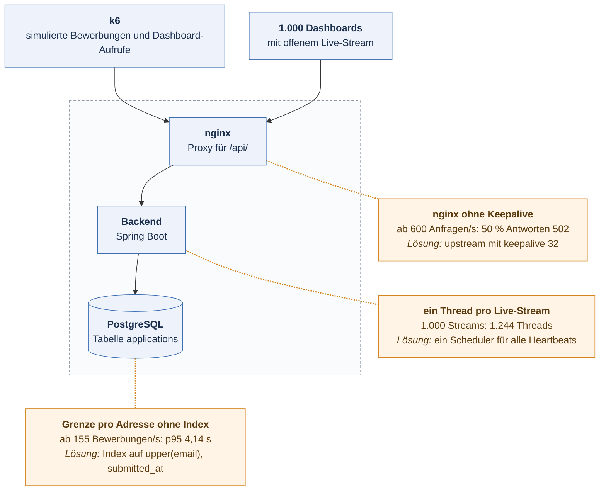
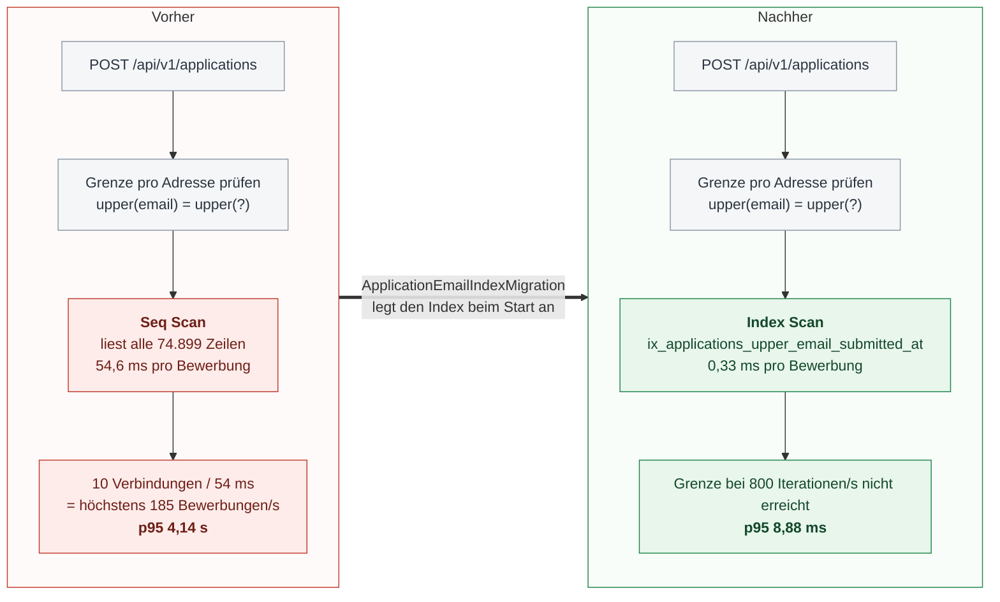
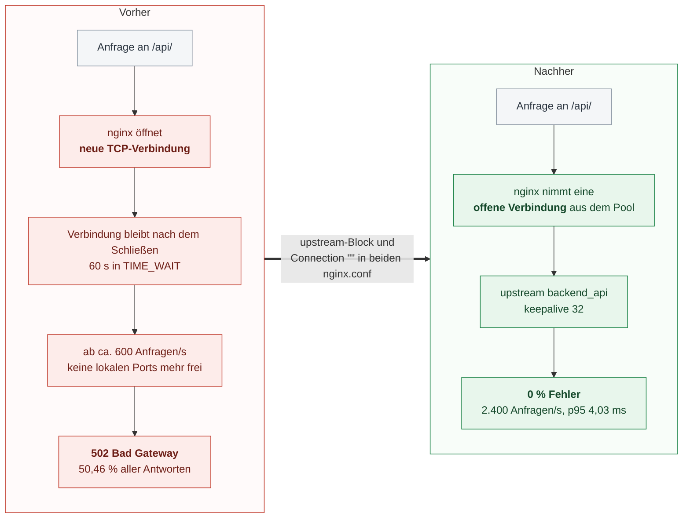
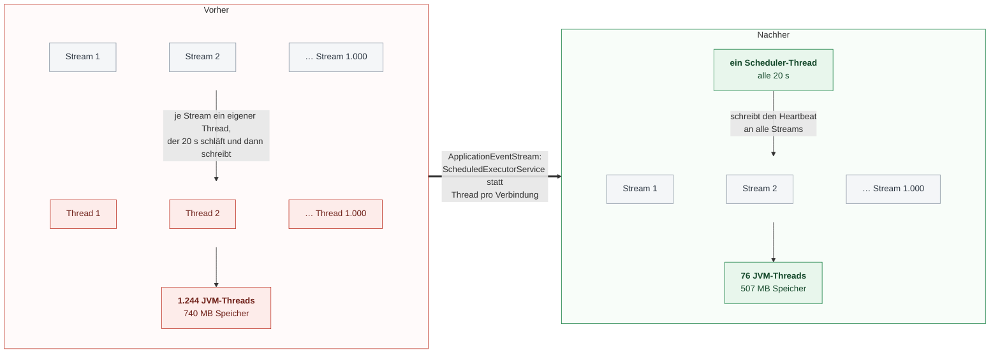

# Ergebnisse der Lasttests

Lauf am 25.11.2026 gegen einen eigenen Compose-Stack (`dtw-load`, siehe
`README.md`) mit den Demo-Daten und leerem `RESEND_API_KEY`. k6 und der Stack
liefen auf demselben Rechner: 22 Kerne, 15 GB RAM, WSL 2, keine Grenzen für
CPU oder Speicher der Container. Die Zahlen gelten für diesen Rechner und
sagen nichts über einen Server im Internet.

Eine erwartete Last gibt es noch nicht, weil die Zahl der Anfragen unbekannt
ist (`A4`). Deshalb liefen nur Smoke, Stress und Spike. Load und Soak brauchen
diese Annahme (#198).

## Kurzfassung

| Szenario | Vorher | Nachher |
| --- | --- | --- |
| Formular direkt, Stress bis 800 Iterationen/s | ab etwa 155 Bewerbungen/s Stau, p95 4,14 s, 79.602 verworfene Iterationen | p95 8,88 ms, 381 Bewerbungen/s im Mittel, 14 verworfene Iterationen |
| Formular direkt, Spike auf 300 Iterationen/s | p95 839,68 ms, 482 verworfene Iterationen | p95 11,24 ms, keine verworfenen Iterationen |
| Dashboard, Stress bis 800 Iterationen/s (2.400 Anfragen/s) | 50,46 % Fehler (502), p95 1,15 s | 0 % Fehler, p95 4,03 ms |
| Live-Updates, 1.000 offene Streams | 1.244 JVM-Threads, 740 MB RSS | 76 JVM-Threads, 507 MB RSS |

Keiner der Läufe nach den Änderungen hat eine Grenze erreicht. Wo die neue
Grenze liegt, ist nicht gemessen.

## Überblick

Der Test lief über denselben Weg wie im Betrieb: von k6 über nginx zum Backend
und weiter zu PostgreSQL. An jeder der drei Stationen fand er einen Engpass.
Die gestrichelten Linien zeigen, wo er saß; die Kästen darunter nennen Symptom
und Lösung.



## Engpässe und Änderungen

### Grenze pro Adresse ohne Index



Vor jeder Bewerbung zählt das Backend die Bewerbungen derselben Adresse aus
den letzten 24 Stunden (`A26`). Spring Data erzeugt dafür
`upper(email) = upper(?)`, und dafür gab es keinen Index. PostgreSQL las bei
jeder Bewerbung die ganze Tabelle:

- vorher: `Seq Scan`, 74.899 Zeilen verworfen, 54,6 ms pro Abfrage
- nachher: `Index Scan using ix_applications_upper_email_submitted_at`, 0,33 ms

Mit 10 Verbindungen im Hikari-Pool ergibt das höchstens 10 / 0,054 s ≈ 185
Bewerbungen pro Sekunde, und die Grenze sinkt mit jeder neuen Zeile. Gemessen
waren etwa 155 pro Sekunde. Die CPU des Backends lag dabei unter einem Kern.

Änderung: `ApplicationEmailIndexMigration` legt beim Start den Index
`(upper(email), submitted_at)` an, nach dem Schema-Update von Hibernate.
Hibernate kann keinen Index auf einen Ausdruck deklarieren. Auf H2 in den Tests
passiert nichts, wie bei `ApplicationStatusConstraintMigration`.

Beide Stress-Läufe begannen mit etwa 20.000 Bewerbungen in der Tabelle, beide
Spike-Läufe mit 13.

### nginx ohne Keepalive zum Backend



nginx öffnete für jede Anfrage eine neue TCP-Verbindung zum Backend. Ab etwa
600 Anfragen pro Sekunde lagen so viele geschlossene Verbindungen in
`TIME_WAIT`, dass keine lokalen Ports mehr frei waren:

```
connect() to 172.26.0.3:8080 failed (99: Address not available) while connecting to upstream
```

163.720 von 324.421 Anfragen bekamen 502. Das Backend selbst war dabei nicht
ausgelastet.

Änderung: Beide `nginx.conf` leiten `/api/` über einen `upstream` mit
`keepalive 32` weiter und setzen `Connection ""`. Danach: 405.001 Anfragen,
alle mit 200.

### Ein Thread pro Live-Stream



Jeder geöffnete Stream auf `/api/v1/staff/events` startete einen eigenen
Plattform-Thread, der alle 20 Sekunden den Heartbeat schrieb. 1.000 offene
Dashboards hielten 1.244 Threads im Backend. Eine Obergrenze für Streams gibt
es nicht.

Änderung: Ein einzelner Scheduler-Thread schreibt den Heartbeat an alle
offenen Streams. Der erste Heartbeat geht weiter sofort beim Öffnen raus, die
folgenden alle 20 Sekunden (ADR 0004). Lesende Anfragen blieben in beiden
Läufen schnell: p95 11,06 ms vorher, 9,46 ms nachher.

## Offen

- **Bewerbungsliste ohne Seiten.** `GET /api/v1/staff/applications` liefert
  alle Bewerbungen auf einmal. Bei 74.899 Zeilen dauerte die Antwort für einen
  einzelnen Nutzer im Mittel 831 ms. Mit den 13 Demo-Bewerbungen sind es 4 ms.
  Das ganze Postfach des Vereins hat etwa tausend E-Mails aller Art (`A3`),
  Bewerbungen sind nur ein Teil davon. Zehntausende Bewerbungen sind also weit
  weg, deshalb ist das hier nur notiert.
- **Load und Soak** warten auf eine Annahme zur erwarteten Last.
- **Mailversand.** Seit #195 schickt das Backend die Bestätigung bei jeder
  Bewerbung synchron per SMTP oder Resend, im selben Request. Der Lasttest
  schaltet den Versand ab (`compose.load.yml`), misst ihn also nicht. Mit
  echtem Versand hängt die Grenze für Bewerbungen vom Mailserver ab.
- **Grenze pro Adresse über nginx.** Durch das Formular kommen von einer
  Adresse zehn Bewerbungen sofort, danach eine pro Minute, alle weiteren
  bekommen 429. Ein Lasttest durch nginx misst deshalb nur diese Grenze; die
  Kapazität des Backends misst `form.js` direkt gegen `backend:8080`.

## Messartefakte

In jedem Lauf zeigt k6 ein negatives `min` und ein `max` von etwa 30 s bei
`http_req_duration`. Beides kommt von Zeitsprüngen der Uhr in WSL, nicht vom
Backend: Die Werte treten vor und nach den Änderungen gleich auf und betreffen
einzelne Anfragen. Die p95-Werte oben sind davon nicht betroffen.
